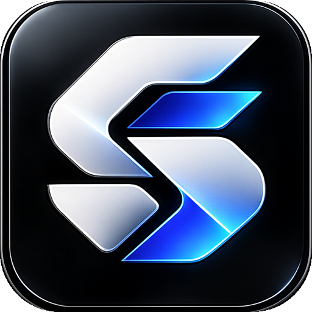
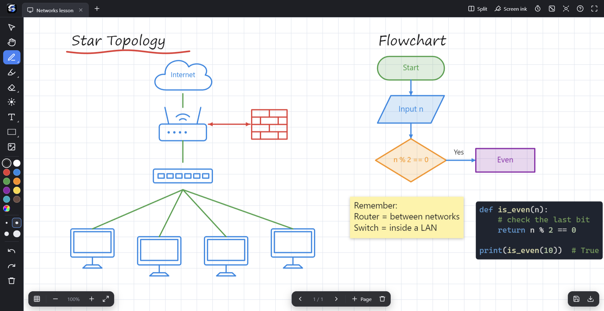
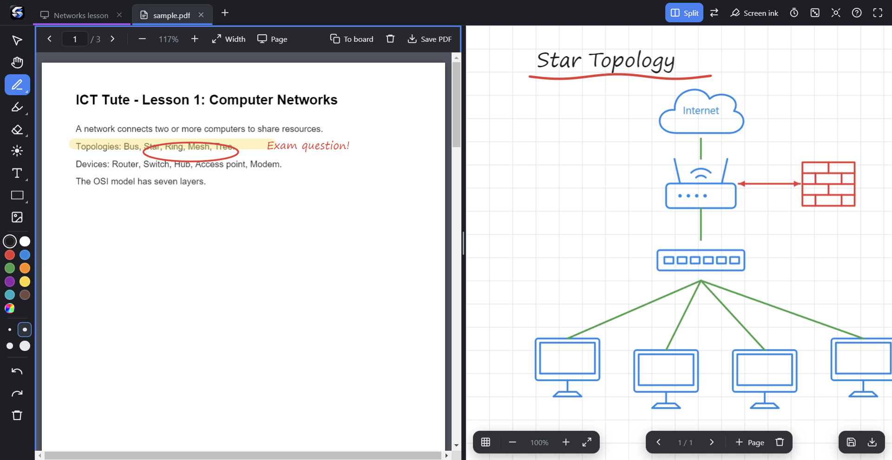
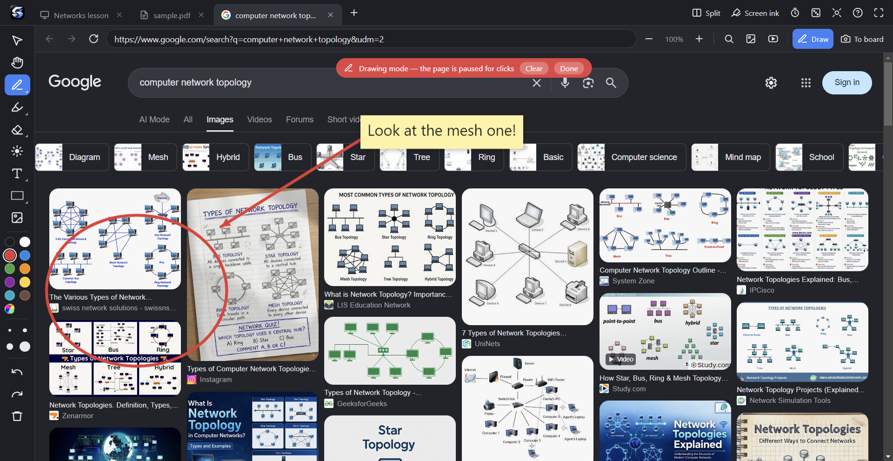
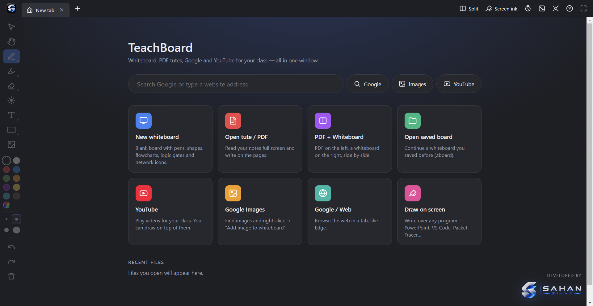
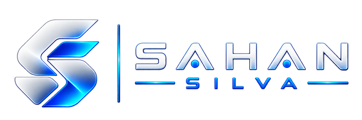

<div align="center">



# TeachBoard

**A digital whiteboard for ICT teachers: draw, write on PDFs, and teach with Google and YouTube, all in one window.**

A free Windows desktop alternative to Microsoft Whiteboard, made for the classroom.


</div>

---



## Why TeachBoard?

Microsoft Whiteboard is being retired, and most whiteboard apps are made for business meetings, not for teaching. TeachBoard is made for an ICT lesson:

- Draw a **network diagram**, a **flowchart** or a **logic circuit** in seconds with ready-made shapes.
- Open your **PDF tute** and write on it, with your notes saved automatically.
- Search **Google Images** or play a **YouTube** video without leaving the app, and draw on top of it.
- Put your PDF and the whiteboard **side by side** on the projector.

## Features

### Whiteboard
- **Pen** (pressure-sensitive with a stylus), **highlighter**, **eraser** (rub out part of a line or a whole object) and a **laser pointer**.
- **Text** as plain text, **sticky notes** or **code blocks** with syntax colours (Python, C, Java, JavaScript, SQL).
- **ICT shape library:**
  - Basic shapes, lines and arrows
  - Flowchart: start/end, process, decision, input/output, subroutine, document, database
  - Logic gates: AND, OR, NOT, NAND, NOR, XOR, XNOR
  - Network and hardware: computer, laptop, server, router, switch, firewall, cloud, user, phone, printer, CPU
  - Tables (for example, truth tables)
- Double-click any shape to **type inside it**.
- **Infinite canvas:** two-finger scroll to move, pinch or Ctrl + wheel to zoom.
- **Multiple pages** and backgrounds (white, grid, dots, ruled, dark, chalkboard, blueprint).
- Select, move, resize, recolour, duplicate and delete; full **undo / redo**.
- **Images:** paste a screenshot, drag and drop, or insert from a file.
- **Save** as a `.tboard` file. **Export** a page as PNG, export all pages as PDF, or copy a page into Word or PowerPoint.

### PDF tutes


- Open any PDF and **write, highlight and draw** on its pages.
- Your writing is **saved automatically** and comes back the next time you open the same PDF. The original file is never changed.
- **Save PDF** creates a copy of the PDF that includes your writing.
- **To board** copies the current page onto a whiteboard.
- Fit to width or fit the whole page; zoom with Ctrl + wheel or pinch.

### Built-in browser (Google, Google Images, YouTube)


- Browse in tabs, like Microsoft Edge.
- Right-click any image and choose **Add image to whiteboard**.
- Click **Draw** to write on top of a web page or a YouTube video.
- **To board** takes a snapshot of the page and puts it on the whiteboard.
- Make pages bigger (**+ / −**) so the class can read them on the projector.

### Classroom tools
- **Split screen:** any two tabs side by side, with a resizable divider.
- **Screen ink:** draw over *any* program (PowerPoint, VS Code, Packet Tracer…), with a mouse mode to click through.
- **Countdown timer and stopwatch**, with an alarm.
- **Random student picker**.
- **Spotlight** to focus the class on one part of the screen.
- **Full screen** (F11) and keyboard shortcuts for everything.



## Getting started

### Requirements
- Windows 10 or 11
- [Node.js](https://nodejs.org/) 18 or newer

### Run from source
```bash
git clone https://github.com/SahansilvaDev/TeachBoard.git
cd TeachBoard
npm install
npm start
```

### Build the Windows installer
```bash
npm run dist
```
The installer (`TeachBoard Setup 1.0.0.exe`) is created in the `dist/` folder. It adds a Start menu entry and a desktop shortcut, and opens `.tboard` files with TeachBoard.

> **Note:** If the build fails with *"Cannot create symbolic link"*, either turn on Windows **Developer Mode** (Settings → System → For developers) or run the terminal as Administrator.

## Keyboard shortcuts

| Keys | Action |
|---|---|
| `V` `H` `P` `M` `E` `L` `T` `S` | Select, Pan, Pen, Highlighter, Eraser, Laser, Text, Shapes |
| `R` / `O` / `A` | Rectangle / Ellipse / Arrow |
| `1` … `0` | Pick a colour |
| `[` / `]` | Thinner / thicker |
| `Space` + drag | Pan the board |
| `Ctrl` + wheel / pinch | Zoom |
| `Ctrl Z` / `Ctrl Y` | Undo / Redo |
| `Ctrl C` / `Ctrl V` / `Ctrl D` | Copy / Paste / Duplicate |
| `Delete` | Delete selected |
| `Shift` + drag | Straight line / perfect square |
| `Page Up` / `Page Down` | Previous / next board page |
| `Ctrl T` / `Ctrl W` / `Ctrl Tab` | New tab / Close tab / Next tab |
| `Ctrl N` / `Ctrl O` / `Ctrl S` | New whiteboard / Open PDF / Save |
| `Ctrl \` | Split screen on/off |
| `F11` | Full screen |

Click **?** in the top bar inside the app to see the full list.

## Tech stack

| Part | Technology |
|---|---|
| Desktop app | [Electron](https://www.electronjs.org/) 33 (Chromium + Node.js) |
| UI | Plain HTML, CSS and JavaScript (no framework) |
| Drawing engine | HTML5 Canvas, written from scratch |
| PDF rendering | [PDF.js](https://mozilla.github.io/pdf.js/) by Mozilla |
| PDF export | [pdf-lib](https://pdf-lib.js.org/) |
| Browser tabs | Electron `<webview>` |
| Installer | [electron-builder](https://www.electron.build/) (NSIS) |

## Project structure

```
TeachBoard/
├── main.js            # Electron main process: windows, files, browser menu, screen ink
├── preload.js         # Safe bridge between the app and the system
├── src/
│   ├── index.html     # Main window
│   ├── styles.css     # App styles
│   ├── engine.js      # Drawing engine: tools, shapes, text, undo, zoom, export
│   ├── tabs.js        # Start page, Whiteboard, PDF and Browser tabs
│   ├── app.js         # Tabs, split view, toolbar, shortcuts
│   ├── widgets.js     # Timer, student picker, spotlight
│   ├── icons.js       # Toolbar icons
│   ├── ink.html/.js   # Screen ink overlay window
│   └── assets/        # App icon and logo
├── public/            # Original logo files
└── docs/screenshots/  # Images used in this README
```

## Where data is stored

- **Whiteboards** are saved wherever you choose, as `.tboard` files (JSON).
- **PDF annotations** are stored in `%APPDATA%\TeachBoard\annotations\`, so your original PDFs stay untouched.
- The **recent files** list is kept in `%APPDATA%\TeachBoard\recent.json`.

## Developer

<a href="https://github.com/SahansilvaDev">
  
</a>

Developed by **Sahan Silva** · [@SahansilvaDev](https://github.com/SahansilvaDev)

## License

© Sahan Silva. All rights reserved.
