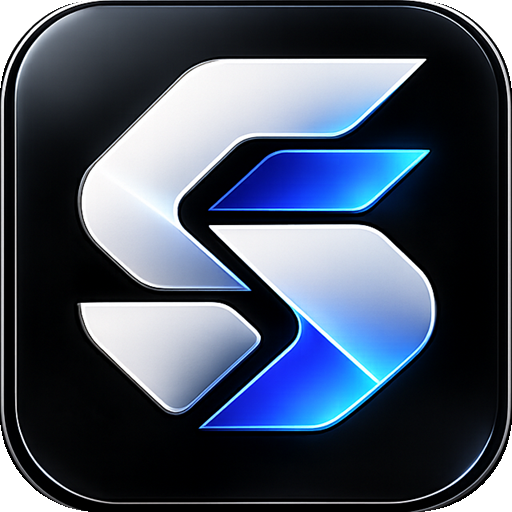
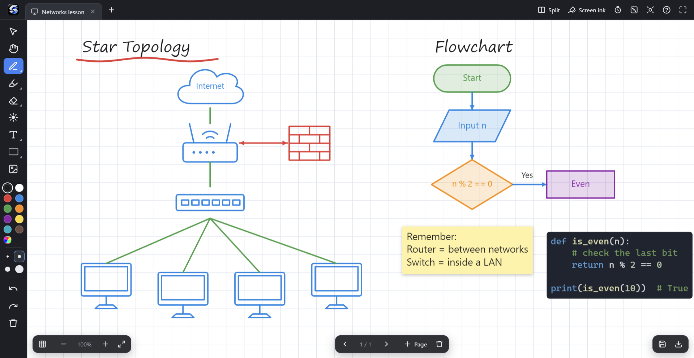
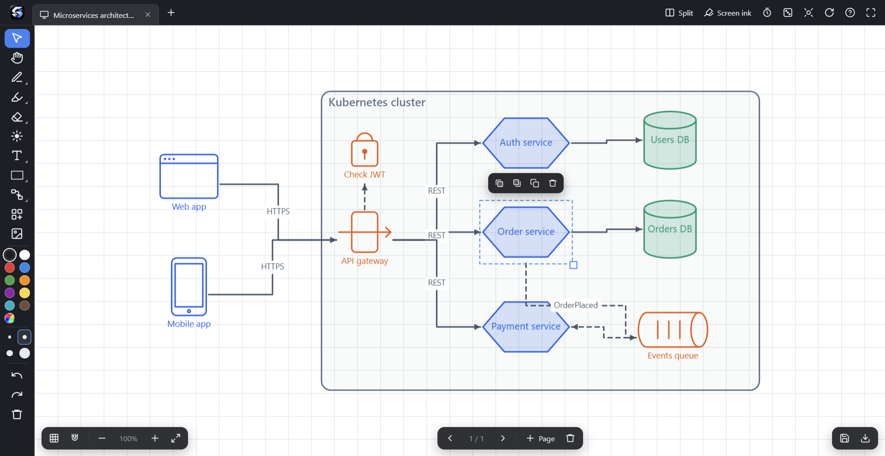
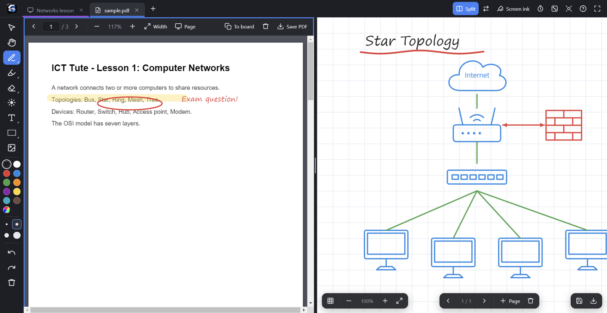
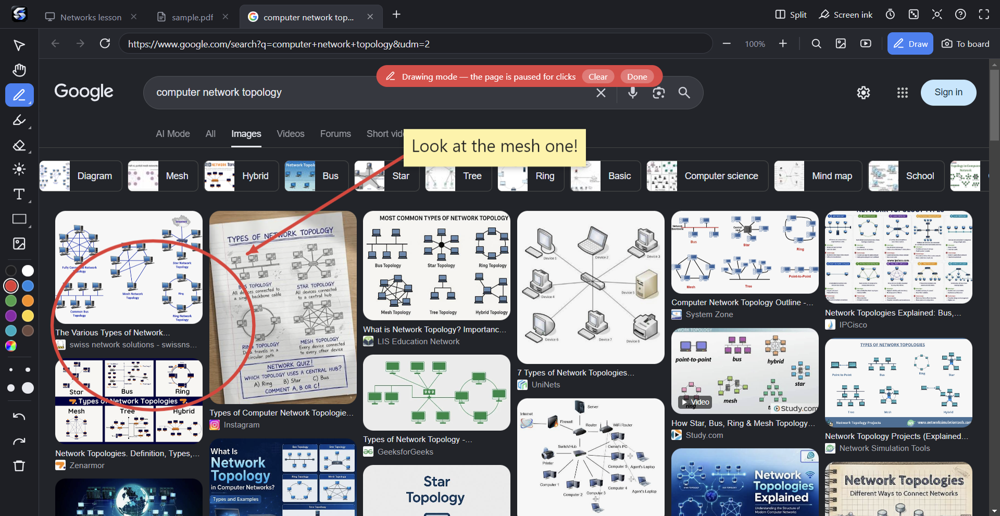
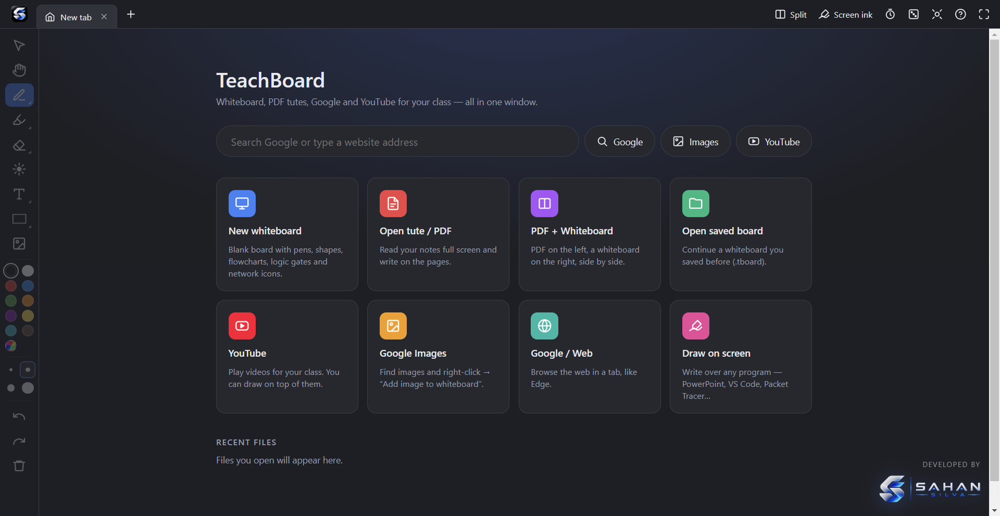
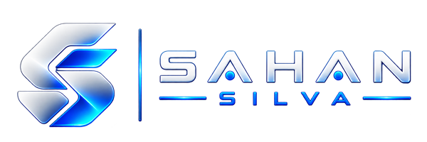

<div align="center">



# TeachBoard

**A digital whiteboard for ICT teachers and software / AI architects: draw, write on PDFs, design architecture diagrams, and teach with Google and YouTube, all in one window.**

A free Windows desktop alternative to Microsoft Whiteboard.


**[⬇ Download the latest version](https://github.com/SahansilvaDev/TeachBoard/releases/latest)**

</div>

---



## What's new in version 2.1

- **Never lose your drawings:**
  - a **minimap** (board overview) in the corner shows everything you drew and where you are; click it to jump there
  - **Show all** (or `Shift+1` / `Home`) brings every drawing back on screen
  - when you've moved to an empty area, a message offers to take you back

## What's new in version 2

- **Architecture diagrams:**
  - smart connectors that stay attached to shapes
  - UML, cloud and AI/LLM shape libraries
  - frames, templates, align tools and snap to grid
- **Smooth handwriting:** touchpad shake is removed, with a Smoothing slider to adjust it.
- **Export fixed:** PNG and PDF export now works on any size of board, and shows a message if something goes wrong.
- **No more white screen on long PDFs:** only nearby pages stay in memory, and there are new **Refresh** and **Reload** buttons.
- **Nothing gets lost:** open tabs, PDFs (on the same page) and whiteboards come back after closing, reloading or a crash.
- **Automatic updates** from GitHub Releases.

See [CHANGELOG.md](CHANGELOG.md) for the full list.

## Why TeachBoard?

Microsoft Whiteboard is being retired, and most whiteboard apps are made for business meetings, not for teaching. TeachBoard is made for an ICT lesson:

- Draw a **network diagram**, a **flowchart** or a **logic circuit** in seconds with ready-made shapes.
- Open your **PDF tute** and write on it, with your notes saved automatically.
- Search **Google Images** or play a **YouTube** video without leaving the app, and draw on top of it.
- Put your PDF and the whiteboard **side by side** on the projector.
- Sketch a **software or AI system architecture** with arrows that follow the boxes when you move them.

## Features

### Whiteboard
- **Pen** (pressure-sensitive with a stylus), **highlighter**, **eraser** (rub out part of a line or a whole object) and a **laser pointer**.
- **Ink smoothing** for steady handwriting with a touchpad or mouse. Click the pen again to change the **Smoothing** slider.
- **Text** as plain text, **sticky notes** or **code blocks** with syntax colours (Python, C, Java, JavaScript, SQL).
- **ICT shape library:**
  - Basic shapes, lines and arrows
  - Flowchart: start/end, process, decision, input/output, subroutine, document, database
  - Logic gates: AND, OR, NOT, NAND, NOR, XOR, XNOR
  - Network and hardware: computer, laptop, server, router, switch, firewall, cloud, user, phone, printer, CPU
  - Tables (for example, truth tables)
- Double-click any shape to **type inside it**.
- **Infinite canvas:** two-finger scroll to move, pinch or Ctrl + wheel to zoom.
- **Board overview (minimap):** see the whole board in the corner, with your drawings and where you are. Click or drag in it to move there. **Show all** (`Shift+1` / `Home`) fits every drawing on screen, and a message appears if you've moved away from everything you drew.
- **Multiple pages** and backgrounds (white, grid, dots, ruled, dark, chalkboard, blueprint).
- Select, move, resize, recolour, duplicate and delete; full **undo / redo**.
- **Images:** paste a screenshot, drag and drop, or insert from a file.
- **Save** as a `.tboard` file.
- **Export:**
  - a page, or just what's on screen, as PNG
  - all pages as PDF
  - copy a page to paste into Word or PowerPoint
- **Auto-save:** boards are saved in the background, so a crash or restart never loses your drawing.

### Architecture diagrams (for software and AI architects)


- **Smart connectors** (press `C`):
  - Drag from one shape to another; the target turns green when the arrow will attach.
  - Move a box and its arrows follow.
  - Choose elbow, straight or curved lines, arrowheads at either end, and solid or dashed lines.
  - Double-click an arrow to label it (e.g. `HTTPS`, `REST`, `OrderPlaced`).
- **Shape libraries:**
  - **Software / UML:** class (name / attributes / methods), interface, component, package, actor, use case, note, microservice, API, queue, cache, web app.
  - **Cloud & infrastructure:** load balancer, API gateway, container, Kubernetes, serverless function, object storage, CDN, monitoring, auth.
  - **AI / LLM:** LLM, AI agent, vector database, embeddings, RAG retriever, GPU, dataset, prompt, ML model, tool.
- **Frames:** labelled boundaries such as *VPC*, *Backend* or *Kubernetes cluster*. Dragging a frame moves everything inside it.
- **Templates:** 3-tier web app, microservices, RAG pipeline, AI agent with tools, and a school LAN. Every template stays fully editable.
- **Selection toolbar:** align, space evenly, bring to front / send to back, duplicate, delete.
- **Snap to grid** (magnet button) keeps diagrams neat.

### PDF tutes


- Open any PDF and **write, highlight and draw** on its pages.
- Your writing is **saved automatically** and comes back the next time you open the same PDF. The original file is never changed.
- **Save PDF** creates a copy of the PDF that includes your writing.
- **To board** copies the current page onto a whiteboard.
- Fit to width or fit the whole page; zoom with Ctrl + wheel or pinch.
- Works smoothly with long tutes (hundreds of pages): only the pages near the screen are kept in memory.
- **Refresh** redraws the pages if anything looks blank.

### Built-in browser (Google, Google Images, YouTube)


- Browse in tabs, like Microsoft Edge.
- Right-click any image and choose **Add image to whiteboard**.
- Click **Draw** to write on top of a web page or a YouTube video.
- **To board** takes a snapshot of the page and puts it on the whiteboard.
- Make pages bigger (**+ / −**) so the class can read them on the projector.

### Classroom tools
- **Split screen:** any two tabs side by side, with a resizable divider.
- **Screen ink:** draw over *any* program (PowerPoint, VS Code, Packet Tracer…), with a mouse mode to click through.
- **Countdown timer and stopwatch**, with an alarm.
- **Random student picker**.
- **Spotlight** to focus the class on one part of the screen.
- **Full screen** (F11) and keyboard shortcuts for everything.
- **Session restore:** your tabs, PDFs (on the same page), whiteboards and split view come back when you open TeachBoard again.
- **Reload** (top bar, or `Ctrl+Shift+R`) fixes a blank screen in one click, and everything comes back. If the window ever crashes, TeachBoard offers to reload by itself.



## Getting started

### Install (teachers)
1. Go to **[Releases](https://github.com/SahansilvaDev/TeachBoard/releases/latest)**.
2. Download `TeachBoard Setup x.y.z.exe` and run it.
3. If Windows shows *"Windows protected your PC"*, click **More info → Run anyway**. This appears because the app is not code-signed yet.

TeachBoard **updates itself**. When a new version is published, a message appears saying it's downloading. When it's ready, click **Restart & update**. You can also check yourself from **? → Check for updates**.

### Requirements (developers)
- Windows 10 or 11
- [Node.js](https://nodejs.org/) 18 or newer

### Run from source
```bash
git clone https://github.com/SahansilvaDev/TeachBoard.git
cd TeachBoard
npm install
npm start
```

### Build the Windows installer
```bash
npm run dist
```
The installer (`TeachBoard Setup 2.0.0.exe`) is created in the `dist/` folder. It adds a Start menu entry and a desktop shortcut, and opens `.tboard` files with TeachBoard.

> **Note:** If the build fails with *"Cannot create symbolic link"*, either turn on Windows **Developer Mode** (Settings → System → For developers) or run the terminal as Administrator.

## How to release an update

Installed copies check GitHub Releases on start-up and update themselves. **The repository must be public** for this to work.

1. Change `"version"` in `package.json` (for example `2.0.0` → `2.0.1`), and add a note to `CHANGELOG.md`.
2. Build the installer:
   ```bash
   npm run dist
   ```
3. Commit, tag and push:
   ```bash
   git commit -am "TeachBoard v2.0.1"
   git tag -a v2.0.1 -m "TeachBoard v2.0.1"
   git push && git push --tags
   ```
4. On GitHub, open **Releases → Draft a new release**, choose the tag `v2.0.1`, and upload these three files from `dist/`:
   - `TeachBoard Setup 2.0.1.exe`
   - `TeachBoard Setup 2.0.1.exe.blockmap`
   - `latest.yml` (the updater reads this file — don't forget it)
5. Click **Publish release**. Every installed TeachBoard will find the update the next time it starts.

*Shortcut:* with a GitHub token in the `GH_TOKEN` environment variable, `npm run release` does steps 2 and 4 for you (it builds and uploads the release files).

## Keyboard shortcuts

| Keys | Action |
|---|---|
| `V` `H` `P` `M` `E` `L` `T` `S` | Select, Pan, Pen, Highlighter, Eraser, Laser, Text, Shapes |
| `C` | Connector (arrow that sticks to shapes) |
| `R` / `O` / `A` | Rectangle / Ellipse / Arrow |
| `1` … `0` | Pick a colour |
| `[` / `]` | Thinner / thicker |
| `Space` + drag | Pan the board |
| `Shift 1` / `Home` | Show all your drawings |
| `Ctrl` + wheel / pinch | Zoom |
| `Ctrl Z` / `Ctrl Y` | Undo / Redo |
| `Ctrl C` / `Ctrl V` / `Ctrl D` | Copy / Paste / Duplicate |
| `Delete` | Delete selected |
| `Shift` + drag | Straight line / perfect square |
| `Page Up` / `Page Down` | Previous / next board page |
| `Ctrl T` / `Ctrl W` / `Ctrl Tab` | New tab / Close tab / Next tab |
| `Ctrl N` / `Ctrl O` / `Ctrl S` | New whiteboard / Open PDF / Save |
| `Ctrl \` | Split screen on/off |
| `F11` | Full screen |
| `Ctrl Shift R` | Reload (fixes a blank screen; your tabs come back) |

Click **?** in the top bar inside the app to see the full list.

## Tech stack

| Part | Technology |
|---|---|
| Desktop app | [Electron](https://www.electronjs.org/) 33 (Chromium + Node.js) |
| UI | Plain HTML, CSS and JavaScript (no framework) |
| Drawing engine | HTML5 Canvas, written from scratch |
| PDF rendering | [PDF.js](https://mozilla.github.io/pdf.js/) by Mozilla |
| PDF export | [pdf-lib](https://pdf-lib.js.org/) |
| Browser tabs | Electron `<webview>` |
| Installer | [electron-builder](https://www.electron.build/) (NSIS) |
| Auto-update | [electron-updater](https://www.electron.build/auto-update) with GitHub Releases |

## Project structure

```
TeachBoard/
├── main.js            # Electron main process: windows, files, browser menu, screen ink,
│                      #   auto-update, crash recovery, session storage
├── preload.js         # Safe bridge between the app and the system
├── CHANGELOG.md       # What changed in each version
├── src/
│   ├── index.html     # Main window
│   ├── styles.css     # App styles
│   ├── engine.js      # Drawing engine: tools, ink smoothing, shapes, connectors, text, undo, zoom, export
│   ├── shapes-arch.js # UML, cloud and AI/LLM shape libraries
│   ├── templates.js   # Ready-made architecture / network diagrams
│   ├── tabs.js        # Start page, Whiteboard, PDF and Browser tabs
│   ├── app.js         # Tabs, split view, toolbar, shortcuts, session restore, updates
│   ├── widgets.js     # Timer, student picker, spotlight
│   ├── icons.js       # Toolbar icons
│   ├── ink.html/.js   # Screen ink overlay window
│   └── assets/        # App icon and logo
├── public/            # Original logo files
└── docs/screenshots/  # Images used in this README
```

## Where data is stored

- **Whiteboards** are saved wherever you choose, as `.tboard` files (JSON).
- **PDF annotations** are stored in `%APPDATA%\TeachBoard\annotations\`, so your original PDFs stay untouched.
- The **recent files** list is kept in `%APPDATA%\TeachBoard\recent.json`.
- **Open tabs** (for session restore) are kept in `%APPDATA%\TeachBoard\session.json`, and **board auto-saves** in `%APPDATA%\TeachBoard\autosave\`.

## Developer

<a href="https://github.com/SahansilvaDev">
  
</a>

Developed by **Sahan Silva** · [@SahansilvaDev](https://github.com/SahansilvaDev)

## License

© Sahan Silva. All rights reserved.
